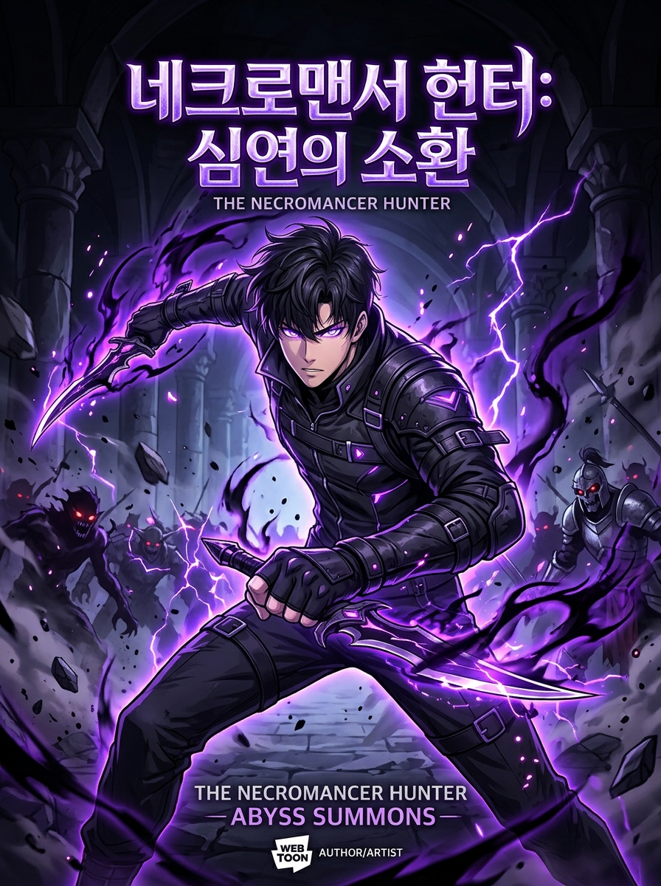

# ⚡ MANHWA VOID — Modern Webtoon Manhwa Reader & Hunter System



**MANHWA VOID** is a modern, high-performance web application designed for reading Korean Webtoons and Manhwa with seamless vertical continuous scrolling, procedural audio effects, RPG Hunter progression, and local chapter importing (.CBZ, .ZIP, and folders).

---

## 🌟 Key Features

### 📖 Continuous Infinite Vertical Webtoon Reader
- **True Webtoon Strip View**: Zero-gap vertical layout with responsive strip width controls (Slim `540px`, Standard `740px`, Wide `960px`).
- **Dynamic Ambient Aura**: The page background emits a reactive atmospheric glow tailored to each manhwa's mana color.
- **Auto-Scroll Engine**: Hands-free vertical scrolling with customizable speed controls (`1x` to `4x`) and Spacebar pause/play toggle.
- **Reading Progress Tracking**: Auto-saves scroll percentage and chapter history to `localStorage`.

### 📁 Awakened Chapter & Archive Importer (.CBZ / .ZIP / Folders)
- **Offline & Scanlation Ready**: Read your downloaded chapters from Asura, Reaper, Tachiyomi, Mihon, etc.
- **Natural File Sorting**: Handles `1.jpg`, `2.jpg`, `10.jpg`, etc. automatically.
- **Client-Side Archive Extraction**: Uses in-browser `JSZip` — no files are uploaded to any server.
- **Instant Demo Chapter**: 1-click test button loads pre-packaged *Solo Leveling Ch. 1* archive.

### 🎮 Hunter RPG System & License
- **Hunter Ranks**: Progress from **E-Rank** to **S-Rank Sovereign**.
- **Daily Hunter Quests**: Earn EXP by reading chapters, bookmarking series, and leaving reactions.
- **Interactive Hunter License**: Flip through stats, completed chapters, total reading time, and unlocked titles.

### 🎵 Procedural Web Audio Engine
- Synthesized audio powered by the **Web Audio API** (no bulky audio files required):
  - 🌌 Ethereal low-frequency ambient dungeon hum
  - ⚔️ Blade swooshes for page navigation
  - 🔔 Crisp crystal chimes for bookmarking and system notifications
  - 🎺 Level-up fanfare for quest completions

### 🌐 Dual Mode: Void Originals & MangaDex Live Feed
- **Void Originals**: Immersive hand-crafted webtoon story panels with Korean SFX, holographic Hunter System windows, and dialogue balloons.
- **MangaDex Live Integration**: Discover trending Korean manhwa titles directly from the MangaDex API with official license detection.

---

## 🛠️ Technology Stack

- **Frontend**: Vanilla HTML5, CSS3, JavaScript (ES Modules)
- **Audio Engine**: Web Audio API (Synthesizers & Oscillators)
- **Archive Engine**: JSZip
- **Server**: Lightweight zero-dependency Node.js HTTP server (`server.js`) with static asset delivery and MangaDex CORS proxy
- **Typography**: Google Fonts (*Outfit*, *Orbitron*, *Plus Jakarta Sans*)

---

## 🚀 Getting Started

### Prerequisites
- Node.js (v18 or newer recommended)

### Installation & Run

1. Clone the repository:
   ```bash
   git clone https://github.com/yashwantraj147-eng/manhwa-void.git
   cd manhwa-void
   ```

2. Start the development server:
   ```bash
   node server.js
   ```

3. Open in your browser:
   ```
   http://localhost:5173/
   ```

---

## ⌨️ Keyboard Shortcuts

| Key | Action |
| --- | --- |
| `/` | Focus global search bar |
| `Space` | Toggle auto-scroll (in reader mode) |
| `Esc` | Close open modals and drawers |

---

## 📜 License

MIT License. Crafted for manhwa enthusiasts and hunters.
